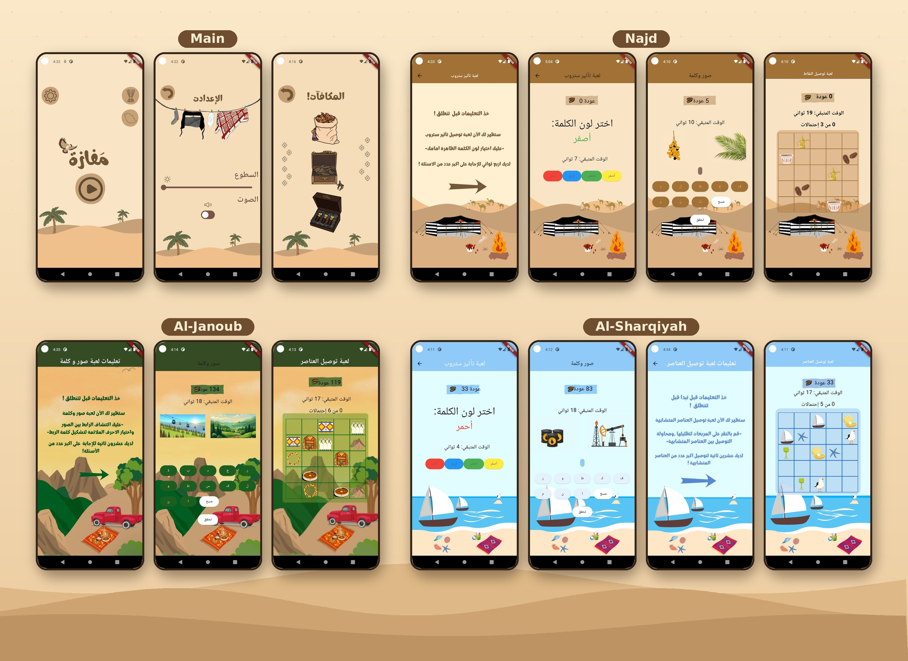

# مَفازة | Mafaza 🦅🏜️

<!-- لوقو اللعبة:  -->

**Train your mind through the landscapes of Saudi Arabia**

---

## 📍 About Mafaza 📍
Mafaza is an educational, game-like app built to enhance **problem-solving skills** and **memory**. Players travel across the regions of Saudi Arabia with a falcon as their guide, solving thought-provoking mini games that sharpen focus and mental agility.

It was developed as the final project for **CS290 Software Engineering** at Imam Mohammad Ibn Saud Islamic University (Dec 2023 – May 2024), following the Scrum methodology.

---

## 🎯 Target Audience

- 🧒 Players aged **10 and above**
- 🧠 Individuals with **ADHD**
- 💪 Anyone who wants to improve memory, focus and problem-solving

---

## 🌟 Key Features

- **Three Mini Games** 🎮: Each one trains a different cognitive skill
- **Journey Across Saudi Arabia** 🗺️: Unlock new regions as you progress, each with its own visuals and atmosphere
- **Falcon Guide** 🦅: A falcon character that encourages and guides the player
- **Rewards System** 🏆: Earn points in every game and collect Saudi-inspired rewards
- **Progressive Difficulty** 📈: Challenges get harder as you move forward
- **Short Instructions** 📝: A clear, brief explanation before each game
- **Timed Challenges** ⏱️: A countdown keeps every round exciting
- **Calm Design** 🎨: Subtle colors, clear fonts and soft sounds to help players focus
- **Settings** ⚙️: Adjust the brightness and turn the sound on or off
- **Arabic Interface** 🇸🇦: Built entirely in Arabic
- **Free to Play** 💚: No payments required to unlock levels

---

## 🎮 Mini Games

### 🎨 Stroop Effect (تأثير ستروب)
A color name appears written in a different color, for example the word "blue" written in red. Pick the **color of the text**, not the word itself.

### 🖼️ Pictures & Word (صور وكلمة)
Three related pictures appear along with scrambled letters. Find the word that connects all the pictures.

### 🔗 Connect the Dots (توصيل النقاط)
Connect matching objects with lines **without letting the lines cross**.

---

## 🗺️ Game Levels

| Region | Theme |
| --- | --- |
| 🏜️ **Najd** | Desert dunes, a Bedouin tent and camels |
| ⛰️ **Al-Janoub** | Green mountains and cable cars |
| 🌊 **Al-Sharqiyah** | The sea, boats and oil fields |

Locked regions appear in black and white, and unlocked ones are shown in color.

---

## 💻 Tech Stack

- 🚀 **Flutter & Dart**: Core application development
- 🐙 **GitHub**: Version control and team collaboration
- ⚙️ **GitHub CI/CD**: Automated testing
- 📋 **Scrum**: Agile development with sprint planning and reports

---

## 🏗️ Architecture & Design

- **Pipe and Filter:** the game is made of stages, and each stage must be completed before the player moves to the next one.
- **Strategy Pattern:** every mini game implements a common interface, which keeps the code loosely coupled and makes it easy to add new games in the future.

---

## 🧪 Testing

The project includes **11 test scenarios** covering the game start, level map, points and rewards, settings, timer, and all three mini games. All of them passed, and automated tests ran successfully through GitHub CI/CD.

---

## 📱 Screens Overview

1. **Launch Page (🏠)**
   - The falcon, the start button, and quick access to the map, rewards and settings.

2. **Game Instructions (📝)**
   - A short explanation before every game.

3. **Stroop Effect Game (🎨)**
   - Choose the color of the word from four options before time runs out.

4. **Pictures & Word Game (🖼️)**
   - Find the word that links the pictures using the letters provided.

5. **Connect the Dots Game (🔗)**
   - Connect matching objects without crossing the lines.

6. **Rewards (🏆)**
   - Your collected rewards.

7. **Settings (⚙️)**
   - Brightness and sound controls.

*Every region has its own look: the desert, the green mountains and the sea.*

---

## ℹ️ More Information

[🔗 View Full Design on Behance](https://www.behance.net/gallery/253791019/Mafaza-Educational-App-like-Game)

<!-- رابط التقرير الكامل أو الفيديو التعريفي:
[📄 Full Project Report](YOUR_LINK)
-->

---

## 👩‍💻 Team Members

- [Alshaimaa Ibrahim Alamer](https://github.com/Alshaimaa00)
- Anfal Shatti Alshammari
- Lujain Mohammed Alsuhaibani
- Reema Saad Alghannam
- Rzan Badr AlSaadoun
- Sara Fahad Alayban

**Course Instructor:** Dr. Lames Abdullah Al-Hazza

---

**Sharpen your mind, one game at a time 🦅💛**

